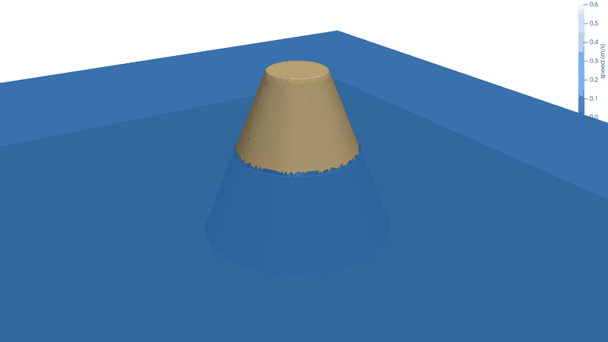
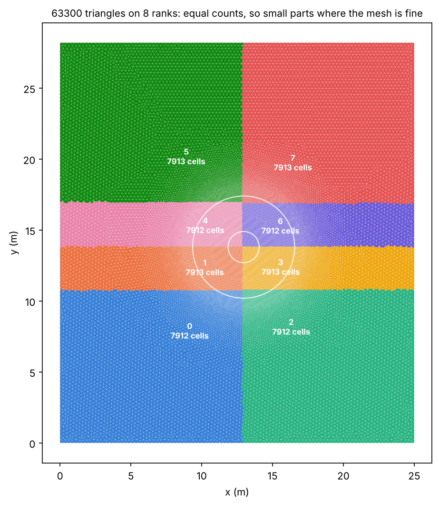
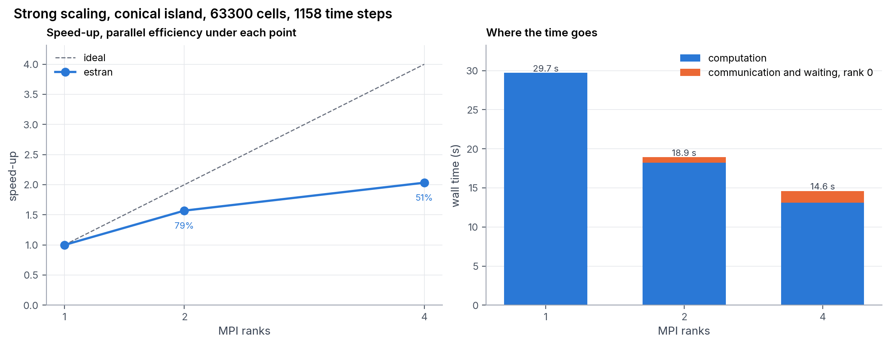
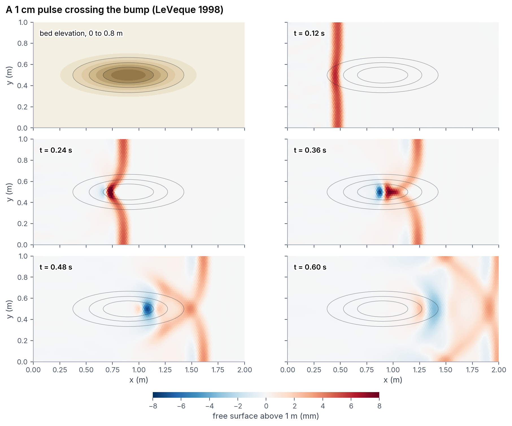
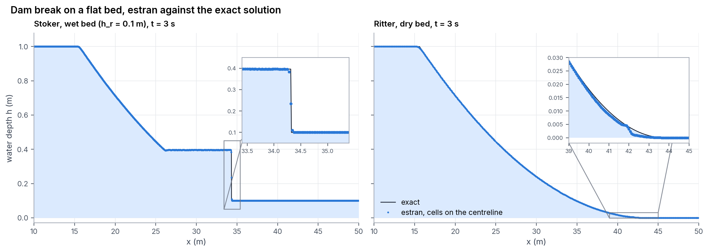
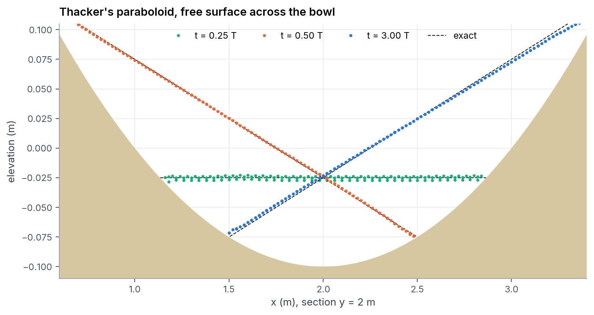
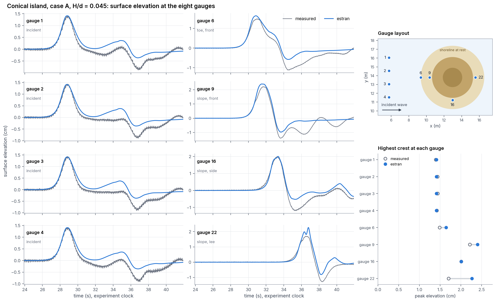
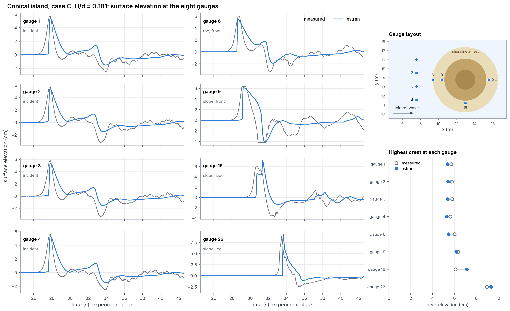
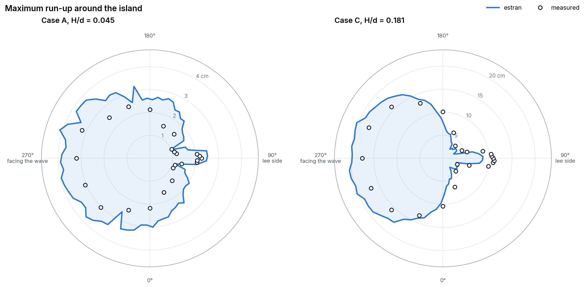

# estran

[](https://github.com/abderrazzak-elammari/estran/actions/workflows/tests.yml)

*Estran*: French for the foreshore, the strip of shore that the tide covers and uncovers.

Shallow water equations on unstructured triangular meshes, in Fortran 2018
with MPI. Cell-centred finite volumes, HLL fluxes, hydrostatic
reconstruction for the bed, second order in space and time, wetting and
drying. Meshes come from Gmsh, results go to ParaView.

The code is checked against three exact solutions and one laboratory
experiment, the solitary wave on a conical island of Briggs et al. (1995).



*Case C of the conical island, H/d = 0.181, rendered in ParaView with
`scripts/paraview_island.py`. The wave splits around the island and the two
fronts meet behind it. Heights exaggerated 10 times, water coloured by speed.*

## Results in short

| test | result |
|---|---|
| lake at rest over a bump | velocities below 3e-13 m/s after 3 156 steps |
| dam break, wet and dry bed | L1 order close to 1 on four meshes, limited by the shock |
| Thacker's paraboloid, moving shoreline | mean depth error 0.37 mm for 100 mm after three periods |
| conical island, case A | gauge peaks within 0.2 cm, except behind the island (+0.57 cm) |
| 1, 2, 3, 5 and 8 MPI ranks | bitwise identical results |

## Build and run

On Ubuntu or WSL:

```
sudo apt install gfortran libopenmpi-dev openmpi-bin gmsh python3-numpy python3-matplotlib
make                  # estran
make meshes           # every mesh from geo/*.geo
make test NP=4        # six checks, about a minute
mpirun -np 4 ./estran cases/island_c.nml
```

Open MPI counts physical cores. On a 4-core, 8-thread laptop, `mpirun -np 8`
needs `--use-hwthread-cpus`.

A run is described by a Fortran namelist (`cases/*.nml`): mesh, case,
final time, output interval, CFL number, gauges. It writes to `out_dir`:

- `<prefix>.pvd`, one `.pvtu` per output time and one `.vtu` piece per rank,
  for ParaView (File > Open the `.pvd`, then Play);
- `diag.csv` (volume, maximum depth), `gauges.csv` (surface elevation at the
  gauges), `errors.csv` when an exact solution exists, `timing.csv`.

`scripts/run_all.sh` runs every case below and redraws every figure
(an hour on 2 cores, most of it one fine mesh). `scripts/paraview_island.py`
renders the 3D frames with `pvbatch` and `scripts/make_gif.py` turns them
into the animation above; `scripts/render_island.py` does the same with
PyVista when ParaView is not installed.

The pieces are written as inline base64. Raw binary would be a third
smaller, but ParaView builds linked against expat 2.6 without the matching
VTK fix (the ParaView 5.11 of Ubuntu 24.04, for one) read raw appended data
as an empty mesh.

## Equations and scheme

With $h$ the depth, $(u, v)$ the depth-averaged velocity, $b$ the bed and
$\eta = h + b$ the free surface:

```math
\partial_t h + \nabla\cdot(h\mathbf{u}) = 0, \qquad
\partial_t (h\mathbf{u}) + \nabla\cdot\left(h\mathbf{u}\otimes\mathbf{u} + \tfrac{1}{2} g h^2 \mathbf{I}\right) = -g h \nabla b - \frac{g n^2 |\mathbf{u}|}{h^{1/3}}\,\mathbf{u}
```

- Fluxes are HLL, computed in the frame of each edge, with Toro's
  two-rarefaction wave speed estimates and the dry-bed limits.
- The bed is handled by hydrostatic reconstruction (Audusse et al. 2004).
  The source term is split into a pressure correction at each edge and a
  centred part $-g h \nabla\eta$ in the cell; at rest every term cancels
  exactly, so a lake at rest stays at rest to round-off.
- Second order comes from least-squares gradients of $(h, u, v, \eta)$ over
  the face neighbours, limited with Barth-Jespersen. The limiter keeps every
  face value inside the range of the neighbouring cell values, which for $h$
  keeps the reconstructed depth non-negative. Cells next to a dry cell
  (below 1 mm) drop to first order, because $\eta$ is meaningless there.
- Time stepping is two-stage SSP Runge-Kutta. The step is
  $\Delta t = \mathrm{CFL}\,\min_i |T_i| / \sum_e |e|\,s_e$, the positivity
  limit of the first-order scheme, with CFL = 0.45 so the MUSCL stages keep
  it.
- Boundaries are walls (mirror state), open (zero gradient) or an incoming
  solitary wave (prescribed depth and velocity at the edge).

## Parallel layout

Every rank reads the mesh and cuts it the same way, by recursive coordinate
bisection of the cell centroids. Cuts are made by cell count, not by
length, so where the mesh is fine the parts are small and every rank gets
the same work:



Each rank keeps its own cells and one layer of ghost cells. A Runge-Kutta
stage does two halo exchanges, the conserved state and then the limited
gradients, with non-blocking point-to-point messages, and one
`MPI_Allreduce` for the time step. Edges between two ranks are computed on
both sides, which costs a few percent of flux evaluations and saves a third
exchange.

Local numbering follows the global numbering, and the edge loop follows
the global edge order. Each cell therefore adds its fluxes in the same order
whatever the partition, and the solution is bitwise identical on any number
of ranks (checked on 1, 2, 3, 5 and 8; `make test` compares 1 and 4). A
parallel bug then shows up as a difference between two runs instead of
hiding in round-off.

Gmsh numbers triangles in the order the mesher created them, which jumps
around in space. Sorting them along a Morton curve of their centroids cut
the run time of the finest dam-break mesh by a third. Output does not go
through rank 0: each rank writes its own `.vtu` piece, and rank 0 only
writes the `.pvtu` and `.pvd` that tie them together.

Strong scaling on the island mesh (63 300 triangles, 1 158 time steps of
case A), on a 4-core laptop:

| ranks | wall time | speed-up | efficiency | M cell updates/s | communication, rank 0 |
|---:|---:|---:|---:|---:|---:|
| 1 | 29.7 s | 1.00 | 100 % | 2.5 | 0 % |
| 2 | 18.9 s | 1.57 | 79 % | 3.9 | 4 % |
| 4 | 14.6 s | 2.03 | 51 % | 5.0 | 10 % |



A cell update is one cell advanced by one time step (two Runge-Kutta
stages). On 4 ranks the exchanges take 10 % of the time, so most of what is
lost is not communication. The four cores share one memory bus and the
clock drops when all of them run; that is where I would look next. With
8 ranks, two per core, the run is slower than with 4 (26.3 s).
`python3 scripts/scaling.py 1 2 4` reruns the table, `--plot` redraws the
figure from the last runs.

## Verification: exact solutions

### Lake at rest

Still water at 1 m over a 0.8 m bump (LeVeque 1998), open boundaries,
11 636 triangles. After 1 s (3 156 steps) the largest velocity is below
$3\times10^{-13}$ m/s and the free surface is flat to $3\times10^{-14}$ m.

### A small pulse over the bump

The same basin with a 1 cm pulse released at $0.05 < x < 0.15$ m. The part
of the wave that crosses the bump is slowed down by the shallower water and
bends, as in LeVeque's original computation.



### Dam break

Channel 50 m by 2 m, 1 m of water behind the dam at $x = 25$ m, compared
with Stoker's solution (0.1 m downstream) and Ritter's (dry bed) after 3 s.



| mesh size | triangles | mean error on $h$ at 3 s | order |
|---:|---:|---:|---:|
| 0.5 m | 1 012 | 2.03e-3 m | |
| 0.25 m | 4 004 | 9.24e-4 m | 1.13 |
| 0.125 m | 14 948 | 5.54e-4 m | 0.74 |
| 0.0625 m | 59 568 | 2.80e-4 m | 0.99 |

First order is what a second-order scheme can reach when the error is
dominated by a shock, which stays one or two cells wide at every
resolution (`figures/dambreak_convergence.png`).

### Thacker's paraboloid

A planar free surface rotating in a parabolic bowl of 1 m radius and 0.1 m
depth (Thacker 1981, as in the SWASHES collection). The shoreline moves all
the time, which makes it the standard test for wetting and drying.
23 264 triangles, three periods.



After three periods the mean error on $h$ over the basin is 0.37 mm for a
depth of 100 mm, growing steadily from one period to the next
(`figures/thacker_error.png`), and the largest error, 7 mm, sits at the
moving shoreline, where the scheme is first order. The basin is closed and
the volume does not change in the twelve printed digits.

## Validation: solitary wave on a conical island

The experiment of Briggs et al. (1995) at the US Army Corps of Engineers:
a 25 m by 28.2 m basin, 0.32 m of water, a truncated cone 0.625 m high
(7.2 m across at the toe, 2.2 m at the crest, slope 1:4) and a solitary wave
from the wavemaker. It is benchmark problem 6 of the US tsunami model
programme (NTHMP), and the data in `data/briggs1995` come from there. The
wave enters through $x = 0$ as a prescribed solitary wave of the measured
height. The mesh follows the toe, the still waterline and the crest of the
island, with 7 cm triangles on the island and 25 cm offshore (63 300
triangles).

The wavemaker clock and the simulation clock differ by a constant, set by
lining up the crests at gauge 2. The gauges do not read zero in still water
(up to 3 mm off), so the mean of their first two seconds is taken as zero.

### Case A, H/d = 0.045



The incident wave (gauges 1 to 4) has the measured height, 1.41 cm against
1.39 to 1.44 cm. In front of the island (gauge 9) the computed peak is
2.40 cm against 2.21 cm, on the side (gauge 16) 2.01 cm against 2.01 cm,
and the crests arrive within a third of a second of the measured ones.
Behind the island (gauge 22) the computed peak is too high, 2.27 cm against
1.70 cm: the two fronts that went round the island meet there, and the
shallow water model keeps them sharper than the real waves, which disperse.

### Case C, H/d = 0.181



A solitary wave is a balance between steepening and dispersion. The shallow
water equations have no dispersion, so a wave this high turns into a bore
within a few metres. The computed front at gauges 1 to 4 is steeper than the
measured one, and everything that follows inherits it.

### Run-up around the island

Highest ground elevation reached by water deeper than 1 mm, in 5 degree
sectors, drawn around the island as seen from above (the wave comes from
the left):



The pattern is right in both cases: highest on the face of the island,
a second maximum on the lee side where the two fronts collide, minima in
between. For case A the computed run-up is too high by 0.58 cm on average
(measured values 1.0 to 3.2 cm). It is not a matter of resolution or of the
1 mm wet threshold:

| case A | mean run-up error |
|---|---:|
| 7 cm cells on the island (63 300 triangles) | +0.58 cm |
| 3.5 cm cells on the island (157 800 triangles) | +0.87 cm |
| 7 cm cells, Manning friction n = 0.012 | +0.46 cm |

Finer cells make it worse and friction helps a little. Two causes I have
not separated yet: the incident wave, a theoretical solitary wave that is
slightly narrower than the one the wavemaker produced (gauges 1 to 4), and
the missing dispersion, which spreads the fronts that collide behind the
island. For case C the front run-up is overestimated (20 cm against
17.5 cm) and the lee side underestimated (8.7 cm against 11.1 cm), again the
bore against the dispersive wave.

## Limits

- No dispersion. Solitary waves higher than a few percent of the depth
  need Boussinesq-type terms; case C shows by how much.
- No breaking model: a bore stands for a breaking wave, which is right for
  the mass and momentum it carries and wrong for its shape.
- First order next to the shoreline, and run-up resolved to one cell; on a
  1:4 slope a 7 cm cell is 1.7 cm of height.
- HLL is diffusive for shear and vorticity. HLLC keeps them better; the
  version I tried upwinded the tangential velocity on the contact wave and
  left spurious plane waves behind a passing pulse on triangles, so I kept
  plain HLL.
- The zero-gradient open boundary is not perfectly transparent: a pulse
  leaving the domain sends back about 2 % of its height at second order.
- Every rank reads the whole mesh. Fine for a few million triangles; beyond,
  the mesh should be partitioned once, offline (`gmsh -part` or ParMETIS),
  and each rank read its piece.
- No adaptive refinement: the mesh is as fine everywhere as Gmsh made it at
  the start.

## Layout

```
src/kinds.f90       kinds, g
src/sort.f90        stable merge argsort
src/mesh.f90        Gmsh 2.2 reader, Morton renumbering, edge connectivity
src/partition.f90   recursive coordinate bisection
src/domain.f90      local and ghost cells, edge lists, halo exchange, reductions
src/config.f90      the namelist
src/cases.f90       beds, initial states, exact solutions, solitary wave boundary
src/solver.f90      reconstruction, HLL, hydrostatic reconstruction, SSP-RK2
src/output.f90      VTK pieces, gauges, errors, diagnostics
src/main.f90        time loop
geo/                Gmsh geometries     cases/      namelists
scripts/            figures, ParaView and PyVista rendering, scaling
tests/check.py      the checks behind make test
data/briggs1995/    laboratory gauges and run-up
```

## References

Audusse E., Bouchut F., Bristeau M.-O., Klein R., Perthame B. (2004). A fast
and stable well-balanced scheme with hydrostatic reconstruction for shallow
water flows. SIAM J. Sci. Comput. 25, 2050-2065.

Briggs M. J., Synolakis C. E., Harkins G. S., Green D. R. (1995). Laboratory
experiments of tsunami runup on a circular island. Pure Appl. Geophys. 144,
569-593.

Delestre O., Lucas C., Ksinant P.-A., Darboux F., Laguerre C., Vo T. N. T.,
James F., Cordier S. (2013). SWASHES: a compilation of shallow water analytic
solutions for hydraulic and environmental studies. Int. J. Numer. Meth.
Fluids 72, 269-300.

LeVeque R. J. (1998). Balancing source terms and flux gradients in
high-resolution Godunov methods: the quasi-steady wave-propagation
algorithm. J. Comput. Phys. 146, 346-365.

Liu P. L.-F., Cho Y.-S., Briggs M. J., Kanoglu U., Synolakis C. E. (1995).
Runup of solitary waves on a circular island. J. Fluid Mech. 302, 259-285.

Stoker J. J. (1957). Water Waves. Interscience.

Thacker W. C. (1981). Some exact solutions to the nonlinear shallow-water
wave equations. J. Fluid Mech. 107, 499-508.

Toro E. F. (2001). Shock-Capturing Methods for Free-Surface Shallow Flows.
Wiley.

## License

MIT.